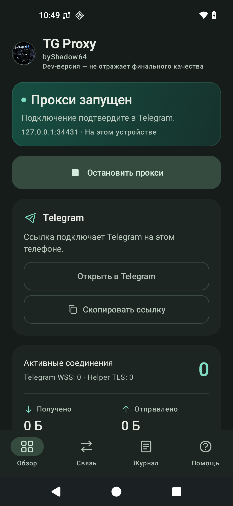
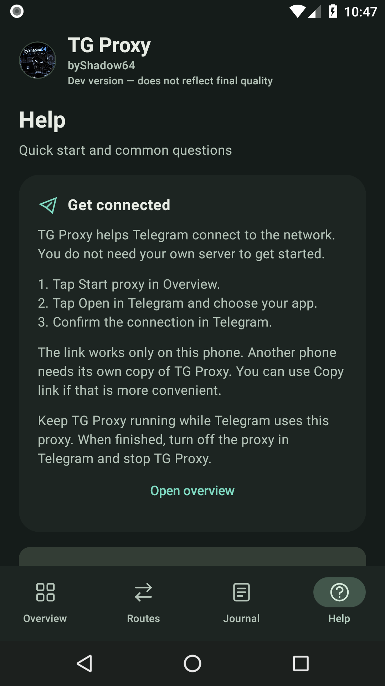

<h1 align="center">TG Proxy</h1>

Telegram через локальный прокси. Windows и Android.

<a href="docs/EN/README.md">English</a> ·
<a href="docs/README.md">Документация</a> ·
<a href="CHANGELOG.md">Что нового</a> ·
<a href="https://github.com/byShadow64/tg-proxy/issues">Сообщить о проблеме</a>

TG Proxy запускает MTProto-прокси на вашем компьютере или телефоне и передаёт
Telegram готовые параметры подключения. Для начала собственный сервер не нужен.
Если прямое соединение недоступно, можно подключить свой Helper.

**Windows 1.15.3 (подготовка)** — Windows 10/11 x64. 
**Android 0.1.7-dev (подготовка)** — Android 8.0 и новее. Мобильная версия находится в разработке.

Текущее дерево готовится к новому выпуску; готовность EXE/APK и границы проверок
указаны в [состоянии проекта](docs/PROJECT_STATE.md).

## Подключение за три шага

1. Запустите TG Proxy. На телефоне нажмите **Запустить прокси** в обзоре.
2. Нажмите **Открыть в Telegram**, выберите приложение и подтвердите подключение.
   Ссылку можно скопировать и открыть самостоятельно.
3. Оставьте TG Proxy работающим, пока Telegram использует этот прокси.

Адрес `127.0.0.1` относится к текущему устройству. Для другого телефона или
компьютера нужна своя запущенная копия TG Proxy. Когда закончите работу,
отключите прокси в Telegram и остановите TG Proxy.

## Windows

Панель показывает состояние прокси, активные соединения, трафик и маршруты.
Программа работает в трее, поддерживает автозапуск и портативный режим.
Настройки и журнал доступны из главного окна.

- Русский и английский интерфейс, светлая и тёмная темы.
- Подключение Telegram по ссылке и встроенная диагностика соединения.
- Журнал с поиском, фильтрами и копированием событий.
- Обновление с прогрессом загрузки, проверкой файла и сохранением настроек.
- Helper по IP и настройка собственного сервера через SSH.

Для готового EXE установленный Python не требуется.

[Руководство Windows](docs/RU/README.windows.md) ·
[Сборка из исходников](docs/RU/BuildFromSource.md)

## Android

&nbsp;

Запуск и остановка доступны в приложении; остановить прокси можно и из
уведомления. Кнопка **Открыть в Telegram** использует системный выбор приложения,
а **Скопировать ссылку** сохраняет параметры работающего локального прокси.

Во вкладке **Помощь** собраны порядок подключения и ответы на частые вопросы.
Обновления проверяются автоматически; загрузку по безлимитному Wi-Fi можно
включить или отключить. Установку подтверждает пользователь в окне Android.
Первый переход с 0.1.5 и более ранних версий выполняется обычной установкой APK
поверх старого приложения.

Android остаётся dev-версией. Проверки на эмуляторах не гарантируют одинаковую
скорость на всех телефонах и сетях.

[Руководство Android](android/README.md) · [Сборка Android](android/BUILDING.md) ·
[Как работают обновления](android/docs/ANDROID_UPDATES.md)

Настроенный сервер обновлений работает независимо от публичности GitHub.
Клиент проверяет подпись и файл перед установкой; административный токен GitHub
не включается в приложение.

## Когда нужен Helper

Helper — дополнительный сервер для соединения с Telegram. Если всё работает
без него, настраивать сервер не нужно.

Для готового Helper с включённым доступом зарегистрированных клиентов достаточно
ввести IP и нажать **Подключить**. Приложение проверит сервер и получит параметры
соединения. Этот режим заранее включает владелец; он разрешает доступ всем
зарегистрированным установкам TG Proxy.

Собственный сервер Ubuntu/Debian можно подготовить через SSH из приложения.
Потребуются права владельца и подтверждение SSH-ключа сервера. Ввод IP сам по себе
не открывает доступ к старому частному Helper.

[Подключение и режимы Helper](docs/RU/Helper.md) ·
[Установка через SSH](docs/SSH_SETUP.md)

## Если соединение не работает

Проверьте, что TG Proxy запущен, а в Telegram выбраны его текущие параметры.
После смены порта откройте ссылку заново. На Android проверьте разрешение фоновой
работы; подробности есть во вкладке **Помощь**.

Отказ одного маршрута ещё не означает отказ всего подключения. Проверяйте
соединение отправкой сообщения и загрузкой файла в Telegram.

В отчёте о проблеме укажите версию, ОС или модель телефона, тип сети, состояние
Helper и шаги воспроизведения. Из журнала уберите пароли, токены и ссылки с
секретом прокси.

## Разработка

Исходники Windows и Helper находятся в корне репозитория, Android — в `android/`.
Для проверки изменений используются тесты, отдельные сборки и проверки готовых
файлов. Выпуск получает один проверенный пакет: EXE не пересобирается отдельно
для каждого канала публикации.

[Участие в разработке](docs/CONTRIBUTING.md) ·
[Состояние проекта](docs/PROJECT_STATE.md) · [Процесс выпуска](docs/PUBLISHER.md)

Основан на [Flowseal/tg-ws-proxy](https://github.com/Flowseal/tg-ws-proxy).
При развитии Android изучался [amurcanov/tg-ws-proxy-android](https://github.com/amurcanov/tg-ws-proxy-android).
Развитие клиентов, интерфейса и Helper — [byShadow64](https://github.com/byShadow64).
Исходная атрибуция сохранена. Лицензия — [MIT](LICENSE).
